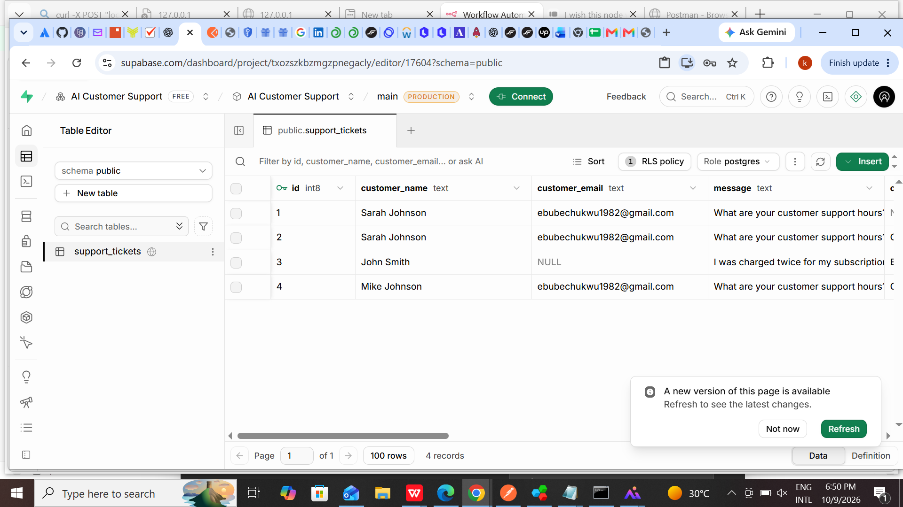

# AI Customer Support & Ticket Management System

## Project Overview

An AI-powered customer support automation system built with n8n, AI agents, Supabase, and a web-based ticket management dashboard.

The system analyzes incoming customer messages, categorizes support requests, assigns priority levels, evaluates customer sentiment, and determines whether a request requires human intervention. It records tickets in a database and supports automated customer responses and human escalation.

## Business Problem

Customer support teams often spend significant time manually reviewing messages, categorizing tickets, identifying urgent issues, and updating ticket records. This can delay responses and make it harder to prioritize customers who need immediate assistance.

## Solution

I developed an automation workflow that combines AI-based message analysis with business rules, database storage, email notifications, and a dashboard for managing support tickets.

## Key Features

- **AI-powered ticket classification:** Categorizes requests into Billing, Technical Support, Account, Shipping, Subscription, or Other.
- **Intent analysis:** Identifies the customer's primary reason for contacting support.
- **Priority assessment:** Assigns Low, Medium, High, or Critical priority.
- **Sentiment analysis:** Identifies Positive, Neutral, or Negative customer sentiment.
- **Human escalation:** Routes requests requiring human attention to a support agent.
- **Automated email responses:** Sends AI-assisted replies for requests handled automatically.
- **Database integration:** Stores customer support tickets and analysis results in Supabase.
- **Interactive dashboard:** Displays ticket records, summary statistics, and analytics.
- **Search and filtering:** Helps users locate tickets by customer information, category, priority, sentiment, and status.
- **Ticket management:** Supports Open, In Progress, and Resolved statuses.
- **Ticket details:** Displays the original message, AI-suggested response, classification, and other ticket information.

## Workflow Architecture

1. A customer submits a support request through a webhook.
2. n8n receives the customer information and message.
3. An AI agent analyzes the message and returns structured information.
4. The workflow parses the AI output.
5. Business rules determine whether the request needs human attention.
6. The appropriate branch records the ticket in Supabase.
7. The workflow sends an automated customer email or an escalation notification.
8. The dashboard retrieves tickets for monitoring and management.

## Technologies Used

- n8n — Workflow automation
- AI agents and large language models — Message analysis and response suggestions
- OpenRouter — AI model integration
- Supabase — Database and REST API integration
- HTML — Dashboard structure
- CSS — Dashboard styling and responsive layout
- JavaScript — Data retrieval, search, filtering, charts, and ticket status updates
- GitHub — Version control and project documentation

## Dashboard Capabilities

The dashboard provides:

- Total ticket count
- Open tickets
- High and Critical priority tickets
- Tickets requiring human review
- In Progress tickets
- Resolved tickets
- Ticket search and filters
- Category, priority, and sentiment analytics
- A detailed ticket view with status management

## Skills Demonstrated

- Workflow design and automation
- AI integration and prompt design
- Structured JSON processing
- Conditional routing and business logic
- Database integration
- Email notification workflows
- Front-end development
- API-based data retrieval
- Debugging and workflow testing
- Building practical business automation solutions

## Setup Overview

1. Import the n8n workflow into your n8n instance.
2. Configure the required AI model and credentials.
3. Configure Supabase and create the required ticket table.
4. Set up the webhook and email credentials.
5. Configure the dashboard to connect to an appropriately secured backend.
6. Test automated responses, human escalation, database storage, and dashboard functionality.

Do not publish API secrets, service-role keys, passwords, or real customer information. Public deployment requires appropriate authentication and database access policies.

## Future Improvements

- Authenticated support-agent access
- Role-based permissions
- Additional notification channels
- Service-level agreement tracking
- More advanced analytics and reporting
- Production-grade monitoring and error handling

- ## Project Screenshots

### Customer Support Dashboard

### n8n Automation Workflow

## Workflow Export

The n8n workflow export is included in this repository:

[`ai-customer-support-workflow.json`](ai-customer-support-workflow.json)

You can review the workflow structure and import it into your own n8n instance after configuring the required credentials and integrations.

### Supabase Ticket Database

The Supabase database stores customer support requests, AI-generated classifications, priority levels, sentiment analysis, escalation requirements, ticket status, and suggested responses.

## Portfolio Disclaimer

This project was developed for educational and portfolio demonstration purposes to showcase AI-powered workflow automation, customer support ticket management, and dashboard development.

The system uses AI-generated classifications and response suggestions, which may require human review before being used in real customer interactions.

Before production deployment, the system should be configured with appropriate authentication, database access controls, secure credential management, error handling, and data privacy safeguards.

This project should be tested with demonstration data before being connected to real customer information.

This project demonstrates AI-assisted customer support automation and ticket management. It is a portfolio project and should be security-reviewed and appropriately configured before production use with real customer information.
